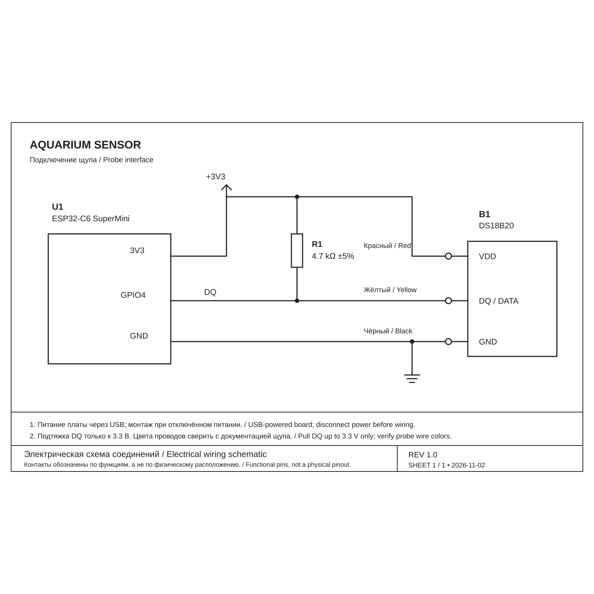

# Aquarium Sensor

**ESP32-C6 · DS18B20 · Zigbee · ESP-IDF 6.1**

[Схема / Wiring](#подключение--wiring) · [Сборка / Build](#сборка-и-прошивка--build-and-flash) · [Проверки / Validation](docs/VALIDATION.md) · [Участие / Contributing](CONTRIBUTING.md)



Датчик температуры воды на ESP32-C6 SuperMini и DS18B20 с прямым Zigbee-подключением к Яндекс Станции Миди. Работа устройства подтверждена владельцем сборки. Wi-Fi, MQTT и отдельный сервер не требуются.

> Water temperature sensor based on ESP32-C6 SuperMini and DS18B20, connecting directly to Yandex Station Midi over Zigbee. Operation has been confirmed by the build owner. Wi-Fi, MQTT, and a separate server are not required.

## Компоненты / Components

Понадобятся ESP32-C6 SuperMini, трёхпроводный герметичный DS18B20, резистор 4,7 кОм, USB-кабель с передачей данных и питание USB. Пригодность оболочки щупа для постоянного погружения нужно уточнять у его производителя; маркировка IP67 сама по себе этого не гарантирует.

> You need an ESP32-C6 SuperMini, a three-wire waterproof DS18B20 probe, a 4.7 kΩ resistor, a USB data cable, and USB power. Check with the probe manufacturer whether its enclosure is suitable for continuous immersion; an IP67 rating alone does not establish this.

## Подключение / Wiring

Отключите USB перед монтажом. Для использованного щупа красный провод подключается к 3V3, чёрный к GND, жёлтый к GPIO4. Резистор 4,7 кОм соединяет DATA и 3V3, а не включается последовательно. Цвета проводов сверяйте с документацией именно вашего щупа. Не подавайте 5 В на GPIO.

> Disconnect USB before assembly. On the probe used in this build, red connects to 3V3, black to GND, and yellow to GPIO4. Connect the 4.7 kΩ resistor between DATA and 3V3, not in series. Verify wire colors against your particular probe documentation. Do not apply 5 V to GPIO pins.

```text
3V3  ----+---------------- VDD
         |
       4.7 kΩ
         |
GPIO4 ---+---------------- DATA
GND  --------------------- GND
```

Плата и соединения должны оставаться сухими, вне аквариума. В воду помещается только подходящий для погружения щуп. Устройство предназначено для наблюдения за температурой; управление нагревателем не реализовано.

> Keep the board and all electrical connections dry and outside the aquarium. Only a probe suitable for immersion goes into the water. This device monitors temperature; heater control is not implemented.

## Сборка и прошивка / Build and flash

Проект использует ESP-IDF, а не Arduino IDE. Сборка проверена с ESP-IDF 6.1 и ESP Zigbee SDK 2.0.5. Установите ESP-IDF и расширение Espressif для VS Code, откройте корень проекта и активируйте окружение ESP-IDF. Зависимости загружаются менеджером компонентов; при первой сборке нужен интернет.

> This is an ESP-IDF project, not an Arduino IDE sketch. The build has been verified with ESP-IDF 6.1 and ESP Zigbee SDK 2.0.5. Install ESP-IDF and the Espressif VS Code extension, open the project root, and activate the ESP-IDF environment. The component manager downloads dependencies; the first build requires internet access.

Выберите ESP32-C6 и соберите проект. Команда set-target предназначена для первоначальной настройки; она пересоздаёт конфигурацию сборки.

> Select ESP32-C6 and build the project. Use set-target for initial configuration; it regenerates the build configuration.

```sh
idf.py set-target esp32c6
idf.py build
```

Определите порт своей платы и подставьте его вместо PORT. Перед записью убедитесь, что подключена нужная плата. Команда flash заменяет прошивку. Для выхода из монитора нажмите Ctrl+].

> Identify your board's serial port and replace PORT below. Verify that the intended board is connected before flashing. The flash command replaces its firmware. Press Ctrl+] to exit the monitor.

```sh
idf.py -p PORT flash monitor
```

## Подключение к Алисе / Pairing with Alice

В приложении «Дом с Алисой» запустите поиск Zigbee-устройств через Станцию Миди. Новая плата автоматически пытается присоединиться к сети. Для повторного сопряжения удерживайте BOOT (GPIO9) пять секунд после запуска и отпустите. Не удерживайте BOOT при включении питания для этой операции.

> In the Home with Alice app, start Zigbee discovery through Station Midi. An unpaired board automatically attempts to join. To pair again, hold BOOT (GPIO9) for five seconds after startup and release it. Do not hold BOOT while powering up for this operation.

Если менялось описание Zigbee-устройства, удалите старую карточку перед повторным сопряжением. После подключения проверьте настоящие показания: согрейте щуп рукой и дождитесь изменения температуры в приложении.

> If the Zigbee device description has changed, remove the old device card before pairing again. After pairing, verify live readings by warming the probe in your hand and waiting for the app temperature to change.

## Измерения и индикация / Measurements and indication

Щуп опрашивается примерно каждые пять секунд. Прошивка отправляет показания при изменении от 0,2 °C либо раз в минуту. Проверяется контрольная сумма ответа. При ошибке передаётся стандартное значение недействительного измерения; отображение ошибки в приложении Яндекса требует отдельной проверки.

> The probe is sampled approximately every five seconds. Firmware reports a change of at least 0.2 °C or sends a periodic report once per minute. Response CRC is checked. Errors produce the standard invalid-measurement value; its presentation in the Yandex app requires separate verification.

Индикация рассчитана на обычный светодиод GPIO15 с активным низким уровнем по распиновке использованной платы. Две короткие вспышки означают ошибку щупа; медленное мигание — ожидание сети при исправном щупе; короткая вспышка раз в пять секунд — исправный щуп и программный статус подключения. Быстрое мигание после удержания BOOT означает готовность сбросить привязку при отпускании. Ошибка щупа имеет приоритет над статусом сети.

> Indication targets a conventional active-low LED on GPIO15, according to the supplied board pinout. Two short flashes indicate a probe error; slow blinking means waiting for the network with a working probe; a brief flash every five seconds indicates a working probe and the firmware's connected state. Fast blinking after holding BOOT means pairing will be reset on release. Probe errors take priority over network status.

Статус подключения и постановка сообщения в очередь не подтверждают получение данных Алисой. Разновидности SuperMini могут отличаться светодиодом и его полярностью. Не все проверки восстановления сети и отображения ошибок завершены.

> Connection status and a queued report do not confirm delivery to Alice. SuperMini variants may use different LEDs or polarity. Network recovery and error-display checks are not yet complete.

## Диагностика / Troubleshooting

Если щуп не найден, отключите питание и проверьте GPIO4, питание 3,3 В, общий GND, резистор между DATA и 3V3 и качество контактов. Сообщение ESP_ERR_NOT_FOUND при отключённом щупе ожидаемо. После восстановления подключения прошивка повторяет попытки чтения.

> If the probe is not found, disconnect power and check GPIO4, the 3.3 V supply, common GND, the resistor between DATA and 3V3, and contact quality. ESP_ERR_NOT_FOUND is expected with no probe attached. Firmware retries reading after the connection is restored.

## Основа проекта / Project references

Референс поведения Zigbee и сервисной кнопки — [VlasovLabTech/Zigbee-ESP32-C6-Alice](https://github.com/VlasovLabTech/Zigbee-ESP32-C6-Alice). Проект перенесён на ESP-IDF; основа API датчика взята из официального примера [Espressif ESP Zigbee SDK](https://github.com/espressif/esp-zigbee-sdk). Уведомления об авторстве в исходниках сохранены. Оригинальные дополнения доступны по MIT; лицензии сторонних компонентов описаны в [THIRD_PARTY_NOTICES.md](THIRD_PARTY_NOTICES.md).

> Zigbee behavior and service-button handling reference [VlasovLabTech/Zigbee-ESP32-C6-Alice](https://github.com/VlasovLabTech/Zigbee-ESP32-C6-Alice). This project targets ESP-IDF; the sensor API implementation is based on the official [Espressif ESP Zigbee SDK](https://github.com/espressif/esp-zigbee-sdk) example. Source attribution notices are preserved. Original contributions are MIT-licensed; see [THIRD_PARTY_NOTICES.md](THIRD_PARTY_NOTICES.md) for third-party terms.

## Настройки / Configuration

Выполните `idf.py menuconfig` → **Aquarium Sensor**. Доступны GPIO щупа,
обычного LED и BOOT, полярность LED, пауза между измерениями, период отправки
и порог изменения в сотых долях °C. По умолчанию: GPIO4 / GPIO15 / GPIO9,
активный низкий LED, 5 с / 60 с / 20 (0,2 °C). Длительность преобразования
щупа добавляется к паузе измерения. Выбирайте GPIO по схеме конкретной платы:
диапазон настройки не гарантирует доступность каждого контакта.

> Run `idf.py menuconfig` → **Aquarium Sensor** to configure probe, conventional
> LED and BOOT GPIOs, LED polarity, sample pause, report interval, and change
> threshold in hundredths of a degree. Defaults: GPIO4 / GPIO15 / GPIO9,
> active-low LED, 5 s / 60 s / 20 (0.2 °C). Probe conversion time adds to the
> sample pause. Consult your board schematic; not every configurable GPIO
> is necessarily available or suitable.

Подключается ровно один DS18B20. Управление адресным RGB-светодиодом не реализовано;
обычную индикацию можно отключить. Wi-Fi и OTA-обновления не используются.

> Connect exactly one DS18B20. Addressable RGB LED control is not implemented;
> conventional indication can be disabled. Wi-Fi and OTA updates are not used.

## Структура / Layout

```text
main/                    Firmware and menuconfig options
components/example_common/  Espressif alarm timer helper
docs/images/            Wiring schematic (SVG and PNG)
docs/VALIDATION.md        Hardware validation checklist
.github/                 Build workflow and contribution templates
dependencies.lock        Exact component versions
sdkconfig.defaults       Portable build defaults
```

Каталоги `build`, `managed_components` и `.local`, а также локальный `sdkconfig`
исключены из Git. Архивы и прежние материалы сохранены в `.local` только у владельца.
Зависимости восстанавливаются по манифесту и lock-файлу. Настройки ESP-IDF и USB-порта
выбираются локально в VS Code и не публикуются.

> `build`, `managed_components`, `.local`, and the local `sdkconfig` are excluded
> from Git. Archives and earlier materials remain in the owner's `.local` folder.
> Dependencies are restored from the manifest and lockfile. ESP-IDF installation
> and serial port settings are local to VS Code and are not published.

## Статус / Status

Версия 0.1.0 готовится к первому релизу. Подробные подтверждения и непроверенные
сценарии перечислены в [листе проверки](docs/VALIDATION.md). Совместимость с другими
хабами и вариантами SuperMini не гарантируется. GitHub Actions проверяет сборку,
но не заменяет испытания на оборудовании.

> Version 0.1.0 is being prepared for its first release. Evidence and untested
> scenarios are tracked in the [validation checklist](docs/VALIDATION.md).
> Other hubs and SuperMini variants are not guaranteed compatible. GitHub Actions
> checks compilation, not hardware behavior.
