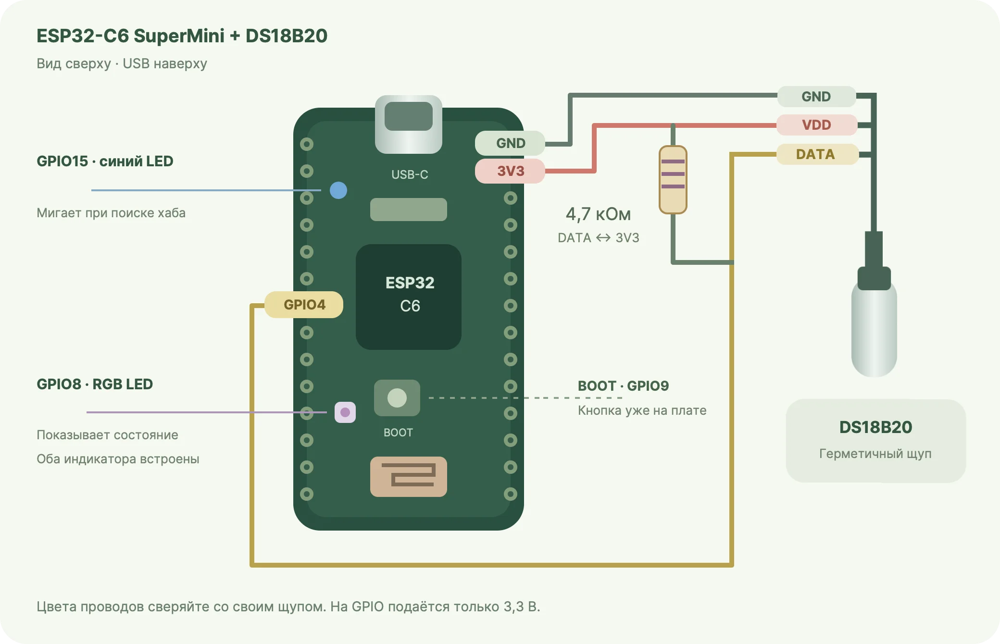

# Сборка устройства

## Компоненты

Нужны ESP32-C6 SuperMini, трёхпроводный DS18B20, резистор 4,7 кОм, USB-кабель с передачей данных и питание USB. Используется один щуп. Индикаторы и BOOT уже находятся на плате.

## Подключение

Перед монтажом отключите USB. Не подавайте 5 В на GPIO.

| Контакт щупа | Контакт платы |
| --- | --- |
| VDD | 3V3 |
| GND | GND |
| DATA | GPIO4 |

Резистор 4,7 кОм соединяет DATA и 3V3, а не включается последовательно.

У использованного щупа красный провод — питание, чёрный — GND, жёлтый — DATA. Цвета сверяйте с документацией своего щупа.

## Размещение

Плата и соединения остаются сухими, вне аквариума. Пригодность оболочки щупа для постоянного погружения уточняйте у производителя: IP67 сама по себе этого не гарантирует.

## Проверка

После [установки прошивки](BROWSER_FLASH.md) посмотрите показания в [«Мой аквариум»](https://rualone.github.io/alice-zigbee-aquarium-thermometer-esp32-c6/). Согрейте щуп рукой и дождитесь изменения температуры.

Если щуп не найден, отключите питание и проверьте GPIO4, 3,3 В, общий GND, резистор между DATA и 3V3 и качество соединений.
